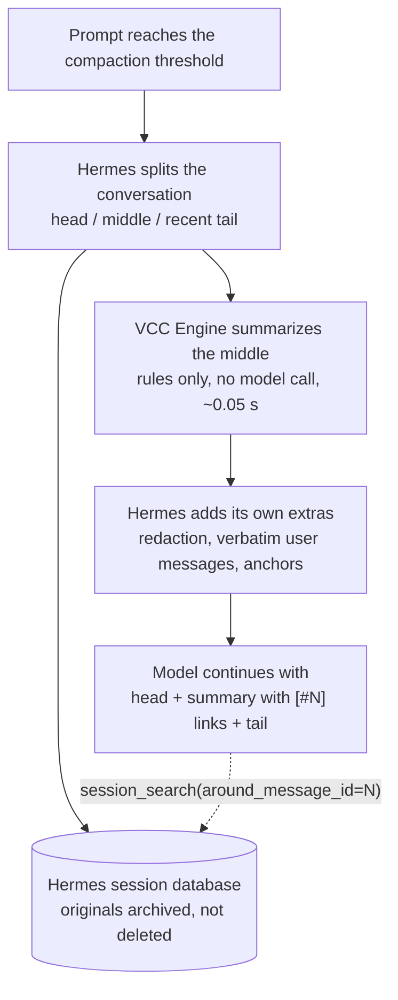

# Instant Context Compactor (Hermes VCC Engine)

[](https://github.com/danbiocchi/hermes-vcc-engine/actions/workflows/ci.yml)
[](LICENSE)


**Hermes compaction in milliseconds, not minutes, and the agent remembers more afterwards.**

When a [Hermes Agent](https://github.com/NousResearch/hermes-agent) conversation fills its context window, Hermes stops and asks your model to write a summary of everything so far. On a local model that takes minutes (a median of 8 in our benchmark, up to 21), and you wait the whole time. This plugin builds that summary in about 0.05 seconds, without calling the model. The summary keeps the exact commands, exit codes, errors and files, and every line links back to the original message.

Based on the research paper [*View-oriented Conversation Compiler for Agent Trace Analysis*](https://arxiv.org/abs/2603.29678) (VCC, arXiv 2603.29678).


## Install in 30 seconds

```bash
hermes plugins install danbiocchi/hermes-vcc-engine --enable
hermes config set context.engine vcc
```

Restart Hermes (CLI, gateway or web UI). Every compaction now logs `vcc: projected N turns into M chars in X ms (no LLM call)`.

Changed your mind? `hermes config set context.engine compressor` puts the stock compressor back.

Works with Hermes `0.21.7` or newer. The engine tests pass on the `v0.21.7` and `v0.22.2` releases, and a live compaction with a local model was checked on `v0.22.2`.

## Who it's for

- ✅ **You run Hermes on a local or slow model**, and long sessions stall for minutes every time the context fills up.
- ✅ **You do long coding or ops sessions** that compact again and again.
- ✅ **You need the agent to keep the facts straight:** which command failed, which error appeared, which files it read or changed.
- ➖ **On a fast cloud API** the stock summary already takes seconds, so the speed gain is small. The recall results below were measured on a local 27B model, not a frontier one.

## What you get

| | Stock Hermes | VCC Engine |
|---|---|---|
| How the summary is made | Your model rewrites up to ~160,000 characters of history | Facts are copied from the recorded messages by fixed rules |
| Summary time on a local 27B model | **8 min** median, up to 21 min | **0.055 s** |
| Model calls per compaction | 1 long generation | **0** |
| "Did command X succeed?" answered correctly | 71 / 108 | **107 / 108** |
| "Was error X raised?" answered correctly | 5 / 18 | **18 / 18** |
| Same input gives the same summary | No | **Yes** |
| Getting back a detail that was cut | Search the history by keyword | **Jump straight to it:** every line carries a `[#N]` link to the original message |


## How it works

Hermes compacts by keeping the start and the most recent part of the conversation and replacing the middle with a summary. VCC Engine changes only one thing: **who writes that summary.** Instead of asking your model, it reads the middle of the conversation and pulls out what an agent needs to keep working:

- 🎯 **Goal:** what you asked for, in your own words
- ⚠️ **Errors & fixes:** what failed, the error text, and where the same call later succeeded
- 📁 **Files:** every file read, modified or written
- 💻 **Commands:** every command, with its exit code and outcome
- 📜 **Session log:** a short excerpt of each message, tagged `[#N]` (if space runs out, the newest are kept)

Nothing is deleted. Hermes archives the original messages in its session database, and the agent can open any `[#N]` in full with `session_search`.



Everything else stays Hermes: when to compact, what stays verbatim, tool-call pairing, redaction and archiving. On the next compaction the previous summary is merged rather than summarized again, so the original goal and the file and command lists carry forward.

### What the summary looks like

From the test fixture `tests/transcripts.py:fix_the_build` (not a real session). The user asks for a fix, the tests fail, the agent patches a file, and the tests pass.

```
## Goal
The build in ~/proj is red, please fix it and keep the public API unchanged.

## Errors & Fixes
- [#1001] terminal `cd ~/proj && pytest -q` — ERROR exit 1: E ImportError: cannot import name 'parse' from 'proj.core' 1 failed → fixed at [#1008]

## Error Names Seen
Named errors that appeared in tool output:
- ImportError (first at [#1002])

## Relevant Files
Every file read or changed with a file tool in this part of the session; terminal commands may have touched others.
- /home/u/proj/proj/core.py — read; modified (patched)

## Commands Run
- `cd ~/proj && pytest -q` — failed (exit 1), then succeeded (exit 0)

## Detailed Session Log (oldest first)
[#1000] user: The build in ~/proj is red, please fix it and keep the public API unchanged.
[#1001] → terminal: `cd ~/proj && pytest -q`
[#1002] ← terminal ERROR exit 1: E ImportError: cannot import name 'parse' from 'proj.core' 1 failed
[#1005] → patch: `/home/u/proj/proj/core.py`
[#1008] ← terminal exit 0: 48 passed in 1.2s
[#1009] assistant: Fixed: 'parse' was renamed to '_parse' in core.py. All 48 tests pass.
```

The session log is shortened here; the real output has one line per message plus a header explaining the `[#N]` links. The full fixture output is in [docs/HOW-IT-WORKS.md](docs/HOW-IT-WORKS.md#a-worked-example).

## The evidence

Every number on this page comes from real Hermes sessions run on real hardware: Qwen3.8-27B (IQ3_S, llama.cpp) on a GTX 1080 + GTX 1070, Hermes `0.21.7`. Current report: **hermes-vcc-engine 0.4.0**. The full method, statistics and threats to validity are in [docs/HOW-IT-WORKS.md](docs/HOW-IT-WORKS.md).

### Recall: does the model still know what happened?

The test used 23 real compaction windows from 4 sessions, with 416 machine-graded questions, each asked in two wordings (832 answers per context). The model got the exact message list Hermes sends after compaction, followed by the question.

| Context the model was given | Correct | |
|---|---:|---:|
| **hermes-vcc-engine 0.4.0** | **757 / 832** | **91.0%** |
| Full window, never compacted | 725 / 832 | 87.1% |
| Stock Hermes (LLM summary) | 634 / 832 | 76.2% |
| Other hermes vcc plugin¹ | 620 / 832 | 74.5% |

¹ The other VCC-based context engine in the Hermes plugin catalog, version 0.1.0 at its pinned commit.

Each comparison below is paired, so every answer is matched with the same question under the other context. The p-value comes from a sign-flip permutation test over windows, and the 95% interval from a bootstrap over windows.

| 0.4.0 vs | Only 0.4.0 right | Only the other right | Difference | 95% CI | p |
|---|---:|---:|---:|---|---:|
| Other hermes vcc plugin | 151 | 14 | +16.5 pts | +11.8 to +21.6 | < 0.001 |
| Stock Hermes | 134 | 11 | +14.8 pts | +10.7 to +19.1 | < 0.001 |
| Full window | 62 | 30 | +3.8 pts | −0.1 to +8.1 | 0.10 |

- **Questions written independently:** 247 questions came from `bench/questions.py`, which was written without reading the summarizer. The order still held: 0.4.0 scored 88.3%, the full window 83.8%, stock 70.4% and the other plugin 67.4%.
- **Windows never seen during development:** 10 windows cut at 64k were never inspected while the summary format was designed. On those, 0.4.0 scored 90.4%, the full window 90.2%, stock 81.1% (p = 0.008) and the other plugin 80.1% (p = 0.011).
- **"I don't know" answers:** 0.4.0 gave 23, the full window 27, stock 71 and the other plugin 94.

All eight question types (independent questions, both wordings):

| Question | 0.4.0 | Full window | Stock | Other plugin |
|---|---:|---:|---:|---:|
| Did command X succeed? | **107 / 108** | 100 / 108 | 71 / 108 | 55 / 108 |
| Did the last command succeed? | **24 / 26** | 21 / 26 | 18 / 26 | 10 / 26 |
| Was command X run? | **41 / 46** | 33 / 46 | 25 / 46 | 29 / 46 |
| Was error X raised? | **18 / 18** | 1 / 18 | 5 / 18 | 0 / 18 |
| Was file X changed? | 86 / 88 | 86 / 88 | 74 / 88 | 84 / 88 |
| Was file X changed? (it was only read) | 55 / 62 | 55 / 62 | 54 / 62 | 55 / 62 |
| Which word was in the user's request? | 90 / 102 | 93 / 102 | 88 / 102 | 83 / 102 |
| How many times was tool X called? | 15 / 44 | 25 / 44 | 13 / 44 | 17 / 44 |

### Speed

| What was measured | Stock Hermes | VCC Engine | |
|---|---:|---:|---|
| The summary step, on the 23 windows (~56–75k tokens) | median 488 s (279–1,261 s) | median 0.055 s | **~9,000x faster.** 2 of 23 stock runs went past Hermes's 15-minute limit. |
| Summary + the model reading the new prompt | median 539 s (347–1,409 s) | median 70 s (22–138 s) | **~9x shorter wait** before the model can start replying (2.9x to 28x per window) |
| Whole pause in real use, including the next full reply (Hermes logs) | median ≈ 443 s (n = 39) | median ≈ 216 s (n = 12) | **~2x shorter** |

Why aren't the last two rows 9,000x? After any compaction the model has to read the new, shorter prompt, and in real use it then writes a full reply. That work is the same under either engine. The real-use row comes from the author's Hermes logs while versions 0.1 and 0.2 were installed. It compares different sessions and context sizes, so treat it as indicative. The summary step's speed hasn't changed meaningfully since 0.2.

### Integrity: does the summary misquote anything?

| Check | Result |
|---|---:|
| Every word in every session-log line appears in the message that line cites | 937 / 937 lines |
| The same check, with a fake word planted to prove it can fail | 17 / 17 caught |
| `[#N]` links in real stored summaries, opened with Hermes's `session_search` | 436 / 436 open the right message |
| Failed commands reported as failed, checked against the raw tool results (69 windows, ~490 commands) | 43 / 43, with 0 wrong outcomes |
| Model calls during a normal compaction | 0 (the tests fail if one happens) |

### The fine print

- **Who it was tested on:** one user's sessions and one model. Your workload and model may give different numbers.
- **What the questions cover:** they are factual and machine-graded. They don't test whether the agent finishes its next task. They don't ask about decisions, reasoning or preferences either, which is what an LLM summary is written to capture.
- **Against the full window:** 0.4.0's +3.8 point lead over never compacting isn't statistically significant. Read it as "about as good as the full transcript", not better.

## Configuration

Everything is optional, set under `context.vcc` in `config.yaml`. Out-of-range values are clamped, and values that can't be parsed fall back to the default.

| Key | Default | Range | Effect |
|---|---|---|---|
| `budget_ratio` | `0.06` | 0.01–0.30 | Summary size as a share of the context window |
| `min_budget_tokens` | `1500` | 300–50,000 | Smallest summary budget |
| `max_budget_tokens` | `8000` | 500–100,000 | Largest summary budget |
| `fallback_to_llm` | `true` | bool | If the summary raises an error, use Hermes's stock LLM summary for that pass |
| `fast_anchors` | `true` | bool | Build Hermes's anchor index with `vcc/anchors.py`, which is checked against Hermes's own builder and switches itself off on any mismatch |

### Hybrid additions (this fork)

| Key | Default | Range | Effect |
|---|---|---|---|
| `record_trigger` | `true` | bool | Adds a `## Compaction Trigger` section naming what asked for the compaction — a manual `/compress` (with its focus topic) or the automatic threshold — which the transcript itself cannot show |
| `preserve_conclusions` | `false` | bool | Runs ONE bounded summary-model call over the agent's own prose and appends it as `## What the Agent Concluded`; the deterministic projection keeps what happened, only a model can keep what the agent concluded |
| `conclusions_input_tokens` | `2500` | 500–60,000 | Cap on the assistant prose handed to that call; tool-result bodies are never included, so the input is a fraction of a full-context summary's. It is a **latency** knob as much as a quality one: Hermes forbids a `max_tokens` wire cap on the summary call (`agent/context_compressor.py:829`), so the model generates as much as it likes and only the *result* is trimmed — a 9,000-token window on this box bought a 16,523-token generation and **113.6 s**, which blew the Redde client's ~45 s `slash.exec` window and showed as `⚠️ Unexpected response: slash.exec timed out` while the compaction itself committed fine (`messages=144->22`) |
| `conclusions_output_tokens` | `900` | 100–4,000 | Cap on the digest it may write back |
| `conclusions_wire_tokens` | `1600` | 0–8,000 | `max_tokens` for the leg's **own** call (it stopped borrowing core's summariser). Core forbids a wire cap on the whole-handoff summary — "NO max_tokens: … a hard cap truncates summaries" (`_call_summary_llm`) — because a length-stop there really is a partial memory, and core raises on `finish_reason=length`. This section earns its cap: the result is trimmed to `conclusions_output_tokens` the moment it lands and the prompt puts the most important bullets first, so a stop at the cap can only cut the tail. Without it, output tracked the stock prompt's section skeleton instead of the material: 5,739 chars of prose produced **4,434 tokens** (32.8 s of a 39.66 s leg) of which only 27% survived the trim; the run before produced 2,837 from *more* input. `0` = uncapped (the old behaviour). Sits ~1.3× above `conclusions_output_tokens` so the last bullet finishes. **Two local-route traps it depends on**, both in `_vcc_digest_call`: a top-level `max_tokens` never reaches the wire on a `custom`/loopback route (`_forwards_max_tokens` forwards it only on Anthropic/NIM/Gemini/OpenRouter/managed llama-server — measured `request_max_tokens=None`, 9,543 tokens generated), so the cap goes through `extra_body` via `auxiliary_max_tokens_param`; and a thinking model spends the whole cap on reasoning and answers with `finish_reason=length` and an **empty** `message.content` (measured 10:47 — a fast leg that ships no section at all), so thinking is disabled for this call with `reasoning: {effort: none}` plus `chat_template_kwargs: {reasoning_effort: none}` (where oMLX-style Qwen servers actually read it). Result: 39.66 s → **10.26 s**, prompt 16,755 → 4,122 tokens, `finish_reason=stop`, 932 tokens |
| `conclusions_row_tokens` | `1000` | 100–20,000 | Cap on each individual reply handed to that call. It is prose, so it is sized like prose: at the 1,200-character excerpt size this used to borrow from the log-line path, a real research session lost 77% of its conclusions (46,872 chars in the window → 10,667 kept) before the model read a word |
| `conclusions_min_prose_rows` | `3` | 1–50 | Below this many qualifying replies the leg declines instead of running: the summariser prompt always asks for its full section skeleton, so a two-excerpt window comes back as ~9k characters of confident reconstruction rather than digestion |
| `conclusions_min_input_chars` | `1200` | 0–100,000 | The same refusal measured in characters |
| `warm_after_compaction` | `true` | bool | After a compaction commits, fire ONE `max_tokens=1` request over the payload the next turn will send, so the provider's prefix cache is warm while the operator is still reading the handoff |
| `warm_after_compaction_delay_s` | `1.0` | 0–30 | Grace period before the prime fires; if a turn is already in flight the prime stands down rather than queueing a prefill ahead of the request the operator is waiting on |
| `warm_after_compaction_max_tokens` | `1` | 1–16 | Tokens the prime may generate — it is buying a prefill, not an answer |
| `warm_after_compaction_idle_probe` | `""` | URL | Engine admin endpoint polled before the prime fires; the prime stands down unless `active_models.total_active_requests + total_waiting_requests` is 0. Empty = no probe, prime on the delay alone |
| `warm_after_compaction_idle_probe_key` | `""` | string | Bearer for that endpoint; empty falls back to `$OMLX_ADMIN_KEY`, then `auth.api_key` in `~/.omlx/settings.json` |
| `warm_after_compaction_probe_timeout_s` | `0.5` | 0.05–10 | Probe budget. An unreachable probe counts as **busy** — a missed warm-up is cheaper than a collided prefill |
| `projection_char_caps` | `{}` | map | Per-item char caps for the deterministic handoff: `user`, `assistant`, `call`, `result`, `error`, `goal`, `task`. Unknown keys are ignored, unparsable values keep the default, values clamp to 40–20,000 — a cap that is too big is a size problem, never a correctness one. `assistant` now defaults to **900** (was 400): on the 10:01:37 compaction a ~4,000-char answer reached the handoff as head+tail with the cut landing mid-word, and the decision inside it lost its argument. Costs ~+2,200 tokens per compaction (~7%), no LLM call |

The digest allowance follows the prose it read: `min(conclusions_output_tokens, max(400, input_chars in tokens))`, because digestion compresses and a section longer than its input is filler dressed as memory. Measured on a live research session: **20,747 chars in → 7,795 out (6.8×)** before the allowance existed, **11,989 → 11,989 (1.0×)** after.

**Priming is measured, not assumed.** On a live session the first model call after a manual `/compress` took **12.16 s to first token on a 38,108-token prompt** while every other call in the same hour — one of them on 74,292 tokens — landed in **0.35–2.38 s**. The model had not cooled (idle eviction off, 1,845 tokens decoded 31 s earlier); the *prefix* was new, and a compaction is exactly what invalidates it.

Three rules the first live runs on 2026-10-26 taught the hard way, all now enforced in code:

- **The prime rides the auxiliary client, not `agent.client`.** That attribute is per-request — `run_agent.py:996` nulls it and `chat_completion_helpers` swaps a live client in only for the duration of one request — so the first prime went out on it and had its response torn off when the turn closed: `OpenAI client closed (agent_close … tcp_force_closed=1)` at `09:09:51`, 17 s after the prime. The compression task now resolves to the session model, so the module-cached aux client answers the same instance with no turn lifecycle at all; `agent.client` remains only as a fallback for a build with no compression task configured.
- **The prime sends the same `tools` array as the live turn.** Schemas are rendered into the
  prompt, so a tools-less prime warms a prefix the next turn cannot reuse: measured on 2026-10-26
  the prime prefilled 31,050 tokens and the operator's turn (`input 38,983`) reported
  `cached 6,592` — only the system prompt overlapped, TTFT 13.9s against the 0.9s a warm
  turn-to-turn call gets. The live call sends `tools=agent.tools`
  (`agent/chat_completion_helpers.py:1528`); `_engine_busy` is the gate, this is the payload.
- **Every prime outcome logs at INFO or above.** A failure was written at DEBUG, which the operator's log level drops, so a torn-off prime looked like silence — no `primed`, no `skipped`, nothing — for four minutes of debugging. Failures now log `vcc: prefix prime failed (…)`, and a prime that is still prefilling when the next turn lands logs `vcc: prefix prime overlapped a live turn`. That overlap is a real cost, not a benign race: the one aborted prime measured **20.95 s** time-to-first-token on the next call (against **15.06 s** with no prime at all), because the turn queued behind a 41k-token prefill it should have replaced. Raise `warm_after_compaction_delay_s`, or set `warm_after_compaction: false`, if your reaction time is shorter than your prefill.

With `preserve_conclusions` off — the default, and upstream's behavior — the engine still makes **no LLM call at all**. Turned on, the leg is strictly additive: if it errors, stalls, or returns nothing, the handoff ships without that section and the deterministic core is unaffected. Both new sections are treated as the engine's own, so a later compaction drops them from the previous summary instead of folding a stale trigger or digest forward.

The budget is the smallest of `budget_ratio` × window, Hermes's own content-scaled summary budget, and `max_budget_tokens`, but never less than `min_budget_tokens`. Hermes doesn't pass its `compression:` settings to plugin engines, so the engine reads the same keys the built-in compressor reads, with the same defaults (`threshold`, `protect_last_n`, `target_ratio` and the rest; see `vcc/engine.py:_compressor_kwargs`).

## Security and privacy

What the plugin's runtime code (`__init__.py` and the `vcc/` folder) does and doesn't do:

- **Network:** no network calls of its own, and no model call on the normal path. If `fallback_to_llm` is on and a summary raises an error, Hermes's own summary call runs for that pass, to the model Hermes is configured to use.
- **Files:** reads Hermes's `config.yaml` once, through Hermes's `load_config_readonly`. It reads no other files, writes no files, and doesn't open `state.db`.
- **No subprocesses, shell commands, environment variables, credentials, background threads, telemetry or self-update.** Python standard library only.
- **Session history:** it works only on the message list Hermes passes in. It never modifies or deletes messages; archiving is Hermes's own behavior.
- **Untrusted tool output is treated as data:**
  - ANSI escapes, control characters and bidi characters are stripped.
  - Chat-template markers (`<|im_start|>`, `[INST]`, `<<SYS>>`, `<think>`) are neutralized.
  - Quoted text can't open a new `##` section.
  - Fuzz tests cover these.
- **Secrets:** the summary goes through Hermes's own `_redact_compaction_text` before Hermes stores it. The plugin relies on that redactor and has no redaction tests of its own.
- **Failure handling:**
  - At startup, if any Hermes internal it needs is missing, the engine runs as the stock compressor and logs a warning.
  - If a summary raises an error, that pass falls back to the stock LLM summary.
  - On 2 of 71 benchmark windows with no user-written messages, Hermes's own provenance check rejected the summary and the pass fell back.
- **Hermes internals:** the engine uses private `ContextCompressor` methods (`_generate_summary`, `_augment_summary_lean`, `_ground_historical_task_snapshot` and others) and private helpers in `agent.conversation_compression` and `agent.auxiliary_client`. These aren't a documented plugin API and can change in a Hermes update. That is why the startup check and fallback exist.

The `bench/` scripts are separate and never loaded by Hermes. When you run them by hand, they read `~/.hermes/state.db` read-only, call your local model server, and write results to `~/.cache/hermes-vcc-engine/` at mode 0600. They print only counts, scores, ids and hashes.

## Limitations

- **It quotes; it doesn't reason.** There are no Key Decisions or rationale sections. Reasons survive only as excerpts of what the assistant wrote.
- **The section rules are heuristics:**
  - "Fixed" means the identical call later succeeded.
  - "Error Names Seen" lists error names found in any tool output, including output from successful commands.
- **The summary is capped:**
  - 40 files, 25 commands, 12 blocked entries, 12 fixes and 20 error names.
  - The session log keeps the newest lines that fit.
  - Anything dropped is still in `state.db`.
- **The `[#N]` links help only if the agent uses them** by calling `session_search`. Messages Hermes hasn't saved yet get `[tN]` labels, which can't be opened that way.
- **The prompt cache still resets.** Every compaction rewrites the prompt, with or without VCC Engine, so the model re-reads it afterwards.
- **Hermes's pruning comes first.** Large old tool results reach the engine as Hermes's one-line stubs. The command and exit code survive, but the output text doesn't.
- **`plugins.isolation: host` is untested.** The engine is built and tested against the default in-process mode.

## Run the benchmarks yourself

Your sessions never leave your machine. Everything is stored under `~/.cache/hermes-vcc-engine/` at mode 0600, and the scripts print no transcript text.

```bash
PY=$(ls -d ~/.hermes/tools/python-*/bin/python3 | head -1)   # the interpreter Hermes uses

# Quick, CPU only
$PY -I bench/proofs.py --synthetic       # faithfulness checks on generated transcripts (runs in CI)
$PY -I bench/proofs.py                   # the same on your own sessions, plus [#N] link checks
$PY -I bench/bench.py --check-golden     # timings, and fail if any output byte changed

# The full head-to-head (needs your local model server; takes hours)
$PY -I bench/certainty.py freeze 98304 65536      # cut your sessions where Hermes would compact them
$PY -I bench/certainty.py compact STOCK           # stock summaries on your model (slow)
$PY -I bench/certainty.py compact v0.4            # this checkout
$PY -I bench/certainty.py ask v0.4 STOCK FULL     # ask the questions under each context
$PY -I bench/certainty.py report                  # scores and paired statistics
```

To benchmark another context engine with the same harness, set `VCC_OTHER=<path to its package>`. The older round-1 harness, `bench/headtohead.py`, is still included.

## Development

```bash
git clone https://github.com/danbiocchi/hermes-vcc-engine && cd hermes-vcc-engine
uv venv --python 3.14 && uv pip install pytest
.venv/bin/python -m pytest tests -q    # 91 tests; CI runs Python 3.11 to 3.14
```

The projector tests run anywhere. The engine and anchor tests need a Hermes checkout (`HERMES_AGENT_DIR`, default `~/.hermes/hermes-agent`) and skip without one. They:
- replace the LLM client with one that fails if called
- run full `compress()` passes
- compare the fast anchor index against Hermes's own
- load the plugin through Hermes's loader in a sandboxed `HERMES_HOME`

`hermes plugins validate . --install-deps` passes on this repository. Version history is in [docs/CHANGELOG.md](docs/CHANGELOG.md).

## Research background

- [VCC](https://arxiv.org/abs/2603.29678) (Lvmin Zhang and Maneesh Agrawala) compiles agent traces into reduced views whose lines keep stable references to the full trace. This plugin is an independent, Hermes-specific implementation of that idea, not the authors' compiler. The paper's AppWorld results don't transfer to Hermes compaction; the numbers on this page are this project's own.
- [The Complexity Trap](https://arxiv.org/abs/2508.21433) found that for software-engineering agents, simply masking old tool output performs about as well as LLM summarization, at lower cost.
- [Factory's compression evaluations](https://factory.com/news/evaluating-compression) found file tracking was the weakest area of every compressor they measured.
- [NoLiMa](https://arxiv.org/abs/2502.05167) and [Sufficient Context](https://arxiv.org/abs/2411.06037) explain why wording matters: models find facts less reliably when the question and the text share no words, and they abstain when the context seems insufficient.

## License

Apache-2.0. `vcc/anchors.py` mirrors the structure of Hermes's anchor index builder (MIT); see [vcc/NOTICE](vcc/NOTICE).
